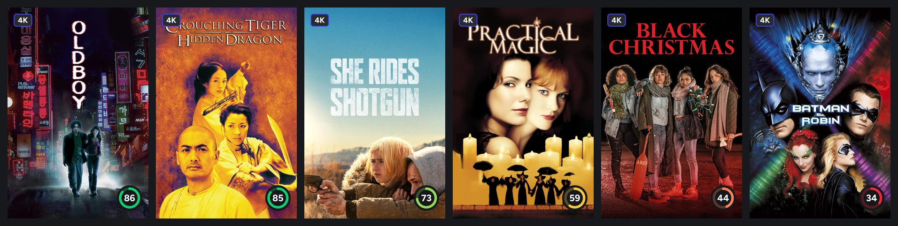
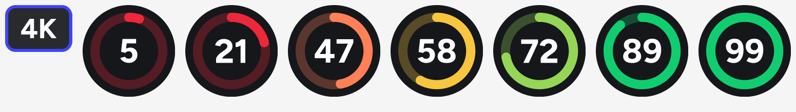

# kometa-config

My [Kometa](https://kometa.wiki) setup for two Plex servers: a main one (**HV**) and a backup that mirrors it (**Ely**). Shared so others can borrow ideas or whole files. Every secret is a `<<placeholder>>`; see [Using these files](#using-these-files).



## Overlays: a 4K label and a score ring

Two things on each poster, and nothing else:

- **Top-left: 4K label** on 4K libraries. Its job is telling the 4K copy from the HD copy at a glance, mostly in Continue Watching, so it's always the same and always in the same place.
- **Bottom-right: score ring.** The arc's length is the score, its colour the band, and the number sits in the middle. It's 56px up from the bottom so Plex's progress bar never covers it.



| Score (out of 100) | 0–34 | 35–49 | 50–64 | 65–79 | 80+ |
|---|---|---|---|---|---|
| Ring colour | deep red | coral | yellow | lime | emerald |

Corners were chosen deliberately: Plex draws its watched tick in the top-right and its progress bar along the bottom edge. The two elements stay separate so neither ever moves: a title without a usable score shows just the 4K label, in the same spot.

### The score: MDBList's average

The ring shows [MDBList](https://mdblist.com)'s **average**: roughly the plain average of IMDb, Letterboxd, TMDb, Trakt, Rotten Tomatoes (critics and audience) and Metacritic (critics and users), on a 0–100 scale. It's shown as a whole number out of 100 so it's never confused with the IMDb rating on Plex's detail page.

Why not IMDb? Plex already shows IMDb on the detail page, so the ring adds a second opinion instead of repeating it. The average is also harder to review-bomb and spreads films out more, so the colours say more. In my 4K library about 85% of films are yellow or green on IMDb's scale, against noticeably more reds and top-band greens on the average.

Why not MDBList's *score*? Despite the name, it isn't a quality score. Above roughly 2,000 IMDb votes it equals the average; below that it's pulled down towards zero, so a well-liked niche concert with a 78 average scores 20. Good for ranking lists, misleading on a poster.

No ring is shown when a title has **fewer than 20 TMDb votes** (too few to trust), no score, or a perfect 100.

How it works:

1. [`tools/sync_scores.py`](tools/sync_scores.py) writes the average into Plex's **user rating** field (as 0–10) for every movie and TV library, every night before Kometa runs. Plex's own audience and critic ratings are left alone, so they keep whatever source Plex gives them. Plex shares a title's user rating across all its copies on a server, so the HD and 4K copies of a film always agree. (Why a script and not Kometa: [see below](#scores-a-script-instead-of-kometa).)
2. [`overlays/score_ring_4k.yml`](overlays/score_ring_4k.yml) has one ring overlay per score (1–99). Each matches its slice of the user rating with a `plex_search`, which lets Plex do the matching (about 3× faster than `plex_all` + `filters` across 100 overlays), plus `filters: tmdb_vote_count.gte: 20`. `ignore_blank_results` keeps empty bands as warnings, not errors.
3. The ring and label are images, not Kometa text: Kometa can't round only some corners or draw arcs, and an image allows the exact design. [`tools/build_overlays.py`](tools/build_overlays.py) draws all of them at 4× and box-downsamples for clean edges.

### Scores: a script instead of Kometa

Kometa can do this itself (`mass_metadata_update` → `ratings: user: [mdb_average, remove]`), and that's how this setup started. It didn't scale on my server. Before writing, Kometa reloads every item from Plex, 100 at a time. A film Plex hasn't read recently takes 3–7 seconds, so behind a reverse proxy with a 30-second timeout every batch of cold films timed out, and one timeout aborts the whole library's operations. Kometa could fill the TV libraries; it couldn't fill any film library.

`sync_scores.py` never reads items one at a time:

- one Plex listing per library, in pages of 500 (IDs and current scores);
- one MDBList request per 100 titles, by TMDb ID for movies and TVDb ID for shows, as Kometa does;
- one Plex batch edit per score value, only for scores that changed.

| | Kometa | Script |
|---|---|---|
| TV Shows (14,000 shows) | ~15 min | ~3.5 min |
| Movies (37,000 films) | timed out every time | ~3 min |
| All 13 libraries (~90,000 titles) | — | ~12 min, ~850 MDBList requests |

It writes the same value Kometa would (average × 0.1, one decimal, field locked), and clears the score when MDBList has none. One difference: an average of 0 means MDBList has no ratings yet, so the title gets no score, where Kometa writes 0.0.

Because a full pass is cheap, every score refreshes every night: no refresh tiers for scores. It has two safety catches. A library whose listing or MDBList lookups keep failing is skipped with no changes. And if an unusual number of real scores would disappear at once (more than 2% of a library, e.g. a partial MDBList response), it clears none of them and logs a warning.

It runs from cron at 03:30 under `flock`, and the Kometa run for the same server waits on the same lock, so overlays always see the night's scores:

```
30 3 * * * /home/ubuntu/kometa-scores/run_scores.sh >> /home/ubuntu/kometa-scores/logs/sync.log 2>&1
0 4 * * *  flock -w 3600 /tmp/kometa-hv.lock docker run --rm ... kometateam/kometa --run
```

### Redrawing rings without re-rendering everything

Kometa 2.5.4's **library schedule modes** let a run process only some items. Scores move most in a title's first weeks, so each 4K library's overlays redraw on tiers (first match wins):

```yaml
schedule:
- schedule: yearly(01/01)
  mode: full            # everything, once a year
- schedule: monthly(1)
  mode: added(400)      # the last ~year, monthly
- schedule: weekly(sunday)
  mode: added(35)       # the last month, weekly
- schedule: daily
  mode: added(2)        # new arrivals (and shows with new episodes), nightly
```

A poster is only redrawn when its score band or number changes. An older title whose score moves gets its new ring at its next tier run.

**Set `tmdb: cache_expiration`.** It defaults to 60 days. Kometa caches each title's TMDb vote count the first time it sees it. A show first seen before it aired is stored with 0 votes, so it fails the 20-vote rule for up to two months, however popular it becomes. Here it's 2 days, which costs only a few hundred free TMDb lookups a night.

Each 4K library has an extra `<Library> Overlays` entry pointing at the same Plex library with `library_name:` and `settings: run_order: [overlays]` (see [`servers/HV/config.yml`](servers/HV/config.yml)). That lets the main entry keep running collections in full every night while the overlays run on the tiers. Showing rings in another library later only needs another Overlays entry, since every library already has scores.

**Put an entry's `run_order` under `settings:`.** Written directly under the entry, Kometa silently ignores it and runs the full default order. An entry with no collection files then still runs a collections step, and that step re-sorts the library's Recommended rows without knowing any sort titles, so they end up alphabetical.

Two things to know if you copy this pattern:

- Kometa keeps a separate "what's on this poster" record per entry, and names its saved originals after the entry (e.g. `Movies 4K Overlays Original Posters`). Only one entry per Plex library should ever have `overlay_files`, or the records drift apart.
- The first run of a new overlays entry fetches each item's current Plex poster as its new original (Kometa marks its own overlaid posters, so it never mistakes one for an original).

## Collections

Hand-written collection files per library rather than Kometa's defaults. Files are in [`servers/HV/`](servers/HV) and [`servers/Ely/`](servers/Ely).

**The basics** (every library): Trending, Popular, Latest, Top Rated, Recently Released and New Episodes, mostly from MDBList lists, IMDb charts and TMDb, plus a few extras (Reality TV, Disney Classics).

**Score rows for films** ([`score_rows_movies.yml`](servers/HV/score_rows_movies.yml)), in Movies 4K, Movies 4Kmini, Movies, Movies International and Kids Movies. The 4K libraries also show them on Home.

A plain "score 80+" rule gave 1,600 films in a 37,000-film library, plenty of them with a handful of votes or a score inflated by one site. So the films are picked by [`tools/sync_scores.py`](tools/sync_scores.py) instead, after the nightly scores. It uses the full MDBList record the score comes from (every site's score and vote count, runtime, genres), so it costs no extra requests:

| Row | Rule |
|---|---|
| Rated 80+ | average 80+, 25,000+ IMDb votes, 60+ minutes, and the sites agree: at least three of IMDb, Letterboxd, RT critics, RT audience and Metacritic (each with enough votes to count), none below 70 |
| Hidden Gems | average 78+, 2,000–25,000 IMDb votes, Letterboxd 3.7+, 70+ minutes, sites agree (none below 65) |
| Under 100 Minutes | average 75+, 75–99 minutes, 10,000+ IMDb votes, sites agree (none below 65) |
| Best Documentaries | documentaries only: average 80+, 5,000+ IMDb votes, 60+ minutes, sites agree (none below 70) |

- Documentaries only appear in their own row.
- Filmed stage shows, concert films and stand-up specials are left out of all four, using TMDb's tags (*filmed theater*, *filmed play*, *musical proshot*, *concert film*, *stand-up comedy*), plus titles ending in ": The Musical" for stage shows TMDb hasn't tagged.
- Only films from 1980 onwards (`ROW_MIN_YEAR`), a personal preference.
- A library's rows avoid showing the same film on the same day.

**Today's selection.** Each night the script picks 50 at random from *every* film that passes a row's rules, and tags them with a Plex label named after the row. One batch edit per 100 films keeps this fast even through a slow proxy. Each row is a Plex smart collection on that label, best score first. It stays the same all day, so you can come back to something you spotted earlier, and the pick is seeded by the date, so a second run on the same day changes nothing.

- **Switching rows off:** a library gets the rows by loading the file. `use_gems: false` / `use_docs: false` in its `template_variables` switch a row off, and the script reads the same switches.
- **Safety:** if a row's pool suddenly shrinks by more than half (a sign of bad data), yesterday's films are kept. `--rows-reset` allows it once after a rule change.

**Why there's no "not watched yet" filter:** Plex works out a smart collection's *unwatched* filter from the **server owner's** watch history, not the viewer's. Shared users would see films they've already ticked, while films the owner had watched would vanish for everyone.

**Score rows for TV** ([`score_rows_tv.yml`](servers/HV/score_rows_tv.yml)), in TV Shows 4K (on Home too) and TV Shows. The same script picks today's 50 shows the same way as the films, with rules adjusted for TV (fewer IMDb votes, no Letterboxd for most shows):

| Row | Rule |
|---|---|
| Rated 80+ | average 80+, 20,000+ IMDb votes, and the sites agree: at least three of IMDb, Trakt, TMDb, RT critics, Metacritic and Letterboxd (each with enough votes to count), none below 70 |
| Hidden Gems | average 78+, 1,000–20,000 IMDb votes (where Rated 80+ starts), reviewed by critics (RT or Metacritic), first aired over a year ago (early scores run high), sites agree (none below 65) |
| Binge-able | finished as planned (not cancelled), one to three seasons, all of it in the library, average 75+, 5,000+ IMDb votes, sites agree (none below 62) |
| Best Documentaries | documentaries only: average 80+, 2,000+ IMDb votes, sites agree (none below 70) |

- Documentaries only appear in their own row; reality, talk, news and game shows are left out.
- Only shows first aired from 1 January 2000 (`TV_FIRST_AIRED`), a personal preference (films go back to 1980).
- Binge-able overlaps with Rated 80+ on purpose: they're for different moods.

**UK streaming rows** ([`streaming_collections.yml`](servers/HV/streaming_collections.yml)), in each library's Recommended tab only:

- *Top on* Netflix, Prime Video, Disney+, Apple TV, Paramount+ and MUBI: MDBList's weekly UK streaming charts (JustWatch data), in chart order.
- *Top on* BBC iPlayer, ITVX, Channel 4 and NOW: MDBList has UK charts for these too, but Kometa's `mdblist_streaming` won't accept them, so [`tools/uk_charts.py`](tools/uk_charts.py) fetches them nightly (before Kometa) and writes each chart's TMDb IDs, in order, into `uk_charts_movies.yml` and `uk_charts_tv.yml` next to `config.yml`. Kometa builds the rows from those files.
  - The codes (`bbc`, `itv`, `al4`, `ntv`) aren't in MDBList's docs or on its website, and MDBList answers a code it doesn't know with the chart for *all* services rather than an error. So the script rejects a chart that matches the all-services one (or is empty, or fails to load) and keeps the previous night's titles.

Each row only shows what's in the library (in chart order), and a row with fewer than 5 is removed. The charts are 20 titles long, so the rows are smaller in the smaller libraries. BritBox has no UK chart any more: BritBox UK was folded into ITVX in 2024.

**Kids rows** ([`kids_rows_collections.yml`](servers/HV/kids_rows_collections.yml)): All Ages (U) and Parental Guidance (PG), each matching both the UK and US ratings because Plex holds a mix of the two, plus Top on Disney+.

Rows are ordered by sort title by [`tools/sort_hubs.py`](tools/sort_hubs.py), run straight after Kometa each night. (Kometa's own `auto_sort_hubs` isn't used: it moves the rows above Plex's built-in ones, which pushes Continue Watching to the bottom of the Recommended tab.) The order: `!1` Trending, `!2` Popular, `!3` Latest / Recently Released, `!4` Top Rated, then `!5`–`!6` for the remaining basics (New Episodes, Disney Classics, Reality TV), `!7_1`–`!7_2` for the kids rows, `!8_1`–`!8_4` for the score rows, and `~01`–`~10` for streaming.

Two gotchas found along the way:

- **No commas in a `smart_label` collection's name.** The label is created fine, but Kometa splits the name on the comma when it builds the smart filter, so the collection comes out empty. Plex also splits on commas when removing a tag, so cleaning up means rewriting each item's label list.
- **A list of values under `all:` means every value at once.** Use `any:` for "rated U *or* G *or* TV-Y".

## Companion tool

[plex-poster-fix](https://github.com/FatPancake-14/plex-poster-fix) runs after Kometa each morning. It repairs posters left broken or blank by failed overlays, matches unmatched items, and gives a show Plex's current main poster when a new season starts (Kometa otherwise keeps redrawing on the poster it first saved), so overlays get redrawn on the new season's art.

## Using these files

- **Secrets** are `<<placeholders>>`. Kometa fills them from `KOMETA_*` environment variables or a `.env` file next to `config.yml`; see [`servers/.env.example`](servers/.env.example). For example `token: <<plex_token>>` comes from `KOMETA_PLEX_TOKEN`.
- **Overlays:** `pip install pillow`, run `python3 tools/build_overlays.py`, then copy `overlays/images/` to `config/overlay-images/` and `overlays/score_ring_4k.yml` to `config/` on your Kometa server. Change sizes, colours, bands or the vote threshold at the top of the script.
- **Scores:** `pip install pyyaml`, copy [`tools/sync_scores.py`](tools/sync_scores.py) to your server and run it with your `config.yml` and library names (add `--dry` to see what it would change). [`servers/HV/run_scores.sh`](servers/HV/run_scores.sh) is my nightly wrapper (it also runs `uk_charts.py`). The overlays need these scores in place before Kometa runs.
- **Font:** [Figtree](https://github.com/erikdkennedy/figtree) (SIL Open Font License, in [`fonts/`](fonts)), weight-matched to Avenir Next Bold.
- **Keeping this repo current:** `tools/pull_from_server.sh` copies each server's live YAML files into `servers/<name>/` and runs [`tools/sanitize.py`](tools/sanitize.py), which replaces secrets with placeholders and refuses to pass anything that still looks like a key, token or IP address.

Kometa version: 2.5.4.
